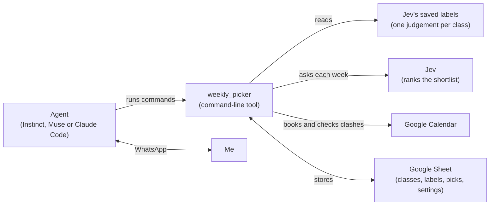
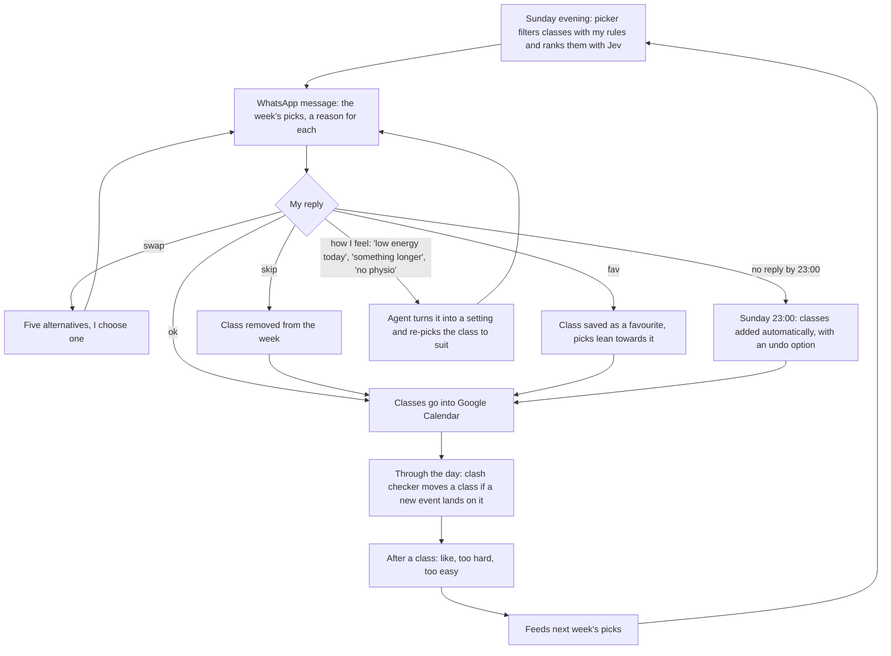

# Weekly fitness class picker


Every Sunday it picks an on-demand fitness class for each of my days (Monday to Thursday, same time each day), explains why, and puts them in Google Calendar. Jev (an AI) judges each class once; plain code does the rest.

<!-- IMAGE: GIF of WhatsApp message to approval to calendar, or remove and use the stills below -->

## Why I built it

- The catalogue I use has 4,746 classes. Scrolling it every day is decision fatigue, and with no routine I did not do much.
- I wanted classes at the same times each week, matched to goals I set: stronger, more flexible, sculpt and tone.
- I wanted to see what Jev could do when it is given a real, narrow job.

## How the jobs are split

- **Me:** I planned it with Claude Code and set every parameter (days, times, goals, equipment, class length).
- **Claude Code:** wrote the code and the tests.
- **Jev:** reads each class once and judges it (goal, strength, weight needed, how gentle it is, physio areas). It ranks the shortlist each week.
- **Plain code:** filters classes, balances the week, books the calendar, checks for clashes. This part must not fail, so no AI sits in it.



## How a week works



Run times: picks at 18:00 on Sunday; a check at 19:00 that tells me if the picks never ran; anything I have not replied to goes into the calendar automatically at 23:00 on Sunday; clash checks every 30 minutes from 07:00 to 21:30. The days, times and goals are my settings (Monday to Thursday), and the run times live in the scheduler, not in this code.

## Code map

| File | Its one job |
| --- | --- |
| `weekly_picker/__main__.py` | Lets you run it as `python -m weekly_picker` |
| `weekly_picker/catalogue.py` | Reads the class catalogue and tidies messy equipment and focus names |
| `weekly_picker/commands.py` | The command-line interface; every command returns the text to send back |
| `weekly_picker/config.py` | A few constants: time zone, cardio cut-off, repeat window |
| `weekly_picker/gcal.py` | Reads busy times and creates, moves and deletes calendar events |
| `weekly_picker/jev.py` | Asks Jev to label and rank classes |
| `weekly_picker/labeller.py` | Runs Jev over every class once, resuming if interrupted |
| `weekly_picker/messages.py` | All the chat wording, one class per line |
| `weekly_picker/models.py` | The data shapes: class, labels, pick, settings |
| `weekly_picker/picker.py` | Plans the week: filter, rank, balance, place in free time |
| `weekly_picker/rules.py` | Filters out classes that break the settings |
| `weekly_picker/sample.py` | Loads the sample folder into an in-memory store (used by the demo) |
| `weekly_picker/store.py` | The only file that touches storage |
| `weekly_picker/timeslots.py` | Free-time maths: nearest free slot, next free weekday |
| `scripts/demo.py` | Plans one week from the sample and prints the picks |
| `scripts/pick_classes.py` | Chooses the sample classes (all three goals, a spread of lengths) and exports a numbered extract with no IDs, links or instructors |
| `scripts/make_sample.py` | How the sample was built: picks rows, swaps real IDs for demo IDs, drops links and instructors |

## How I use it

<!-- IMAGE: still 1, the Sunday message with the week's picks and reasons -->
<!-- IMAGE: still 2, a conversation (a swap, or "ok") -->
<!-- IMAGE: still 3, the approval -->
<!-- IMAGE: still 4, the calendar week -->

## Running it with an agent

It is a plain command-line tool, so any agent that can run commands can drive it. I use Instinct on WhatsApp. Muse and Claude Code also work.

Built with Claude Code; I now talk to it through Instinct on WhatsApp.

Instinct reads this repo for the code. Agents should start with [docs/for-agents.md](docs/for-agents.md): the weekly schedule and which command each reply maps to.

With Claude Code, the weekly booking only needs Haiku. Jev has already made the judgements, so the agent is only running commands and passing on my replies. The cheapest model that can do that reliably is the right one.

## Try the sample

The sample is 20 to 30 classes with made-up names and descriptions rewritten in fresh words. Lengths, difficulty, equipment and focus are unchanged. There are no links and no instructor names, and the class IDs are demo IDs (`C-001` onwards). The labels came from Jev reading the real classes and were carried over to the renamed ones.

```bash
python3 -m venv .venv
```

```bash
.venv/bin/pip install -r requirements.txt
```

```bash
.venv/bin/python scripts/demo.py
```

No Google account and no Jev key needed. The demo ranks from Jev's saved labels. The live version asks Jev each week.

## How it was tested

The test suite runs on every push (see the badge). A few tests need the private catalogue or my live sheet, so they skip on a fresh clone. The situations they cover are in [docs/how-i-tested.md](docs/how-i-tested.md). The design and the decisions behind it are in [docs/design.md](docs/design.md) and [docs/decisions.md](docs/decisions.md).

## What's next

- Images and a short walkthrough of a real week.
- Logging why Jev failed, so "picked without Jev" is easier to diagnose.
- Moving storage from Google Sheets to a database, which only means rewriting `store.py`.

## A note on this repo

This is a snapshot of a private working repo, shared so you can read the real code and tests. It is not kept in sync.
